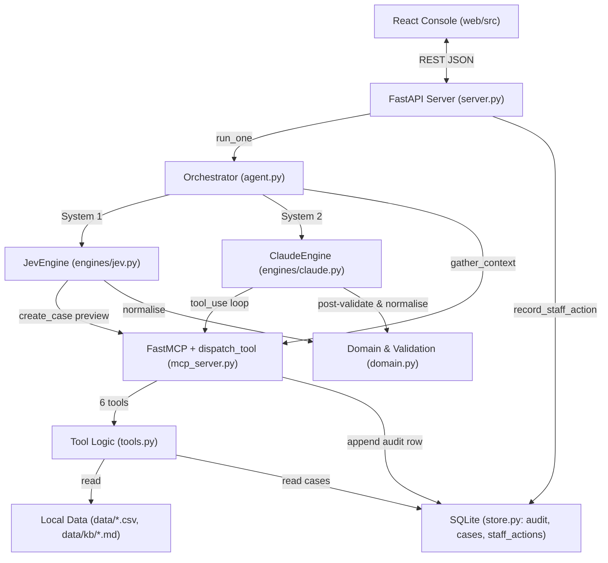
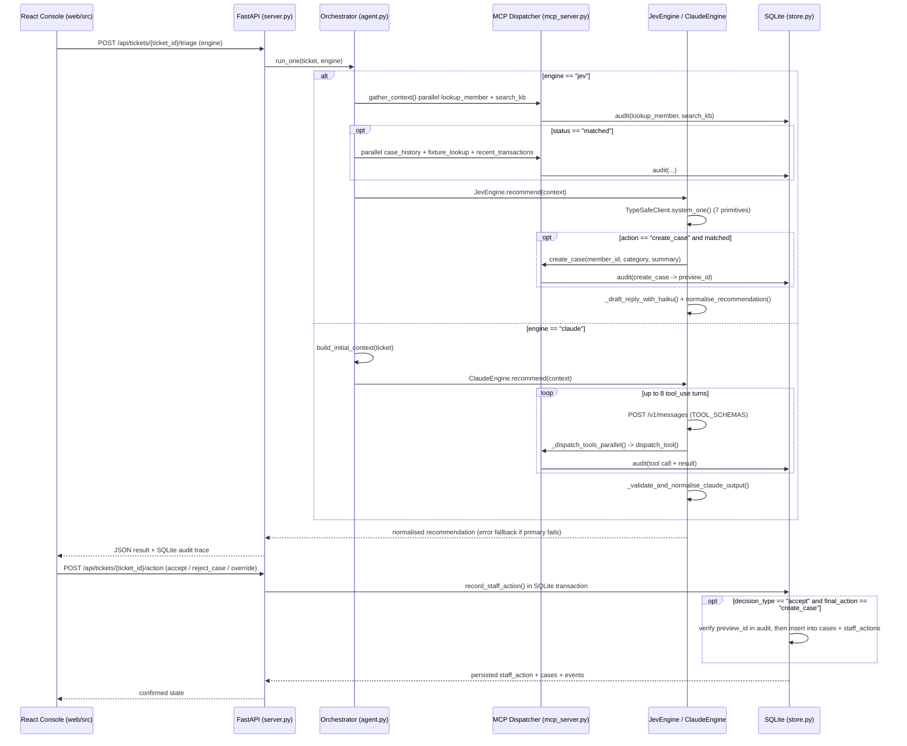

# Northbank FC Member Services Triage Agent

This is a local-first prototype for triaging Northbank FC support emails (`data/tickets.json`, 15 tickets) against 50 synthetic club members (`data/members.csv`) and 7 approved help articles (`data/kb/*.md`). Users can switch in the UI between TypeSafe AI Jev (`jev-latest`) and Claude (`claude-haiku-4-5`), Approve, reject, or override recommendations, keeping a human in the loop before any actions are taken. For debugging purposes, a trace panel is available to inspect MCP tool calls.

## Running locally

Requires Python 3.10+ (and Node.js 18+ if rebuilding `web/`). Add `TYPESAFE_API_KEY` and `CLAUDE_API_KEY` to `.env` (gitignored, never commit keys). If `TYPESAFE_API_KEY` is omitted, the app automatically routes all triage requests through Claude using `CLAUDE_API_KEY`.

```bash
pip install -e '.[dev]'
PYTHONPATH=src python3 -m northbank.server   # http://127.0.0.1:8000
```

- Backend tests (21): `./si_env/bin/pytest -v`
- Frontend tests (17): `npm --prefix web test`
- Evaluation script: `PYTHONPATH=src python3 -m northbank.evaluate` (writes `output/evaluation.csv` from `output/results.json` vs `data/expected_actions.csv`)
- Standalone stdio MCP server: `PYTHONPATH=src python3 -m northbank.mcp_server` (wired in `.mcp.json`)

## System diagram



### Technical request and approval flow



## Design decisions

### Jev (`jev-latest`) as the default classifier

Most of support triage is structured routing (`intent`, `action`, `case_category`, `urgency`) plus binary/probability checks (`kb_grounded`, `identity_confident`, `prompt_injection_risk`). Jev scores all seven in one HTTP call (233.3 ms mean across the 15 tickets, 15/15 accuracy, calibrated probabilities, zero prose tokens). After Jev makes the routing call, `_draft_reply_with_haiku()` runs a single tool-free `claude-haiku-4-5` request (~2.7 s) to write the email reply and rationale from the verified member and KB records. Splitting classification from drafting avoids canned reply templates while staying much faster and cheaper than multi-turn tool loops.

### Why Claude uses Haiku 4.5

On the Claude path, the model only has to pick from 6 MCP tools and match short emails against 7 markdown articles. It does not need a frontier reasoning model. Moving from `claude-sonnet-4-6` to `claude-haiku-4-5` dropped mean latency by 2.7x (14.8 s down to 5.4 s).

### Parallel lookups within a ticket, sequential across the queue

Inside a single ticket, independent MCP lookups (`lookup_member` + `search_kb`, member context tools, and multi-tool `tool_use` batches) run concurrently in a `ThreadPoolExecutor` with `ContextVar` copying so SQLite audit rows keep the right `ticket_id`. Across tickets, `/api/triage-all` intentionally runs one ticket at a time to mimic the performance of real inbound arrival and keep the latency gap between single-pass classification and multi-turn tool loops visible. In production, the API calls would run in parallel, however, I wanted to show the performance increase over system-2 models that you can achieve with Jev.

### MCP, approvals, and guardrails

- `src/northbank/tools.py` holds the 6 tool implementations shared by the stdio FastMCP server and the in-process `TOOL_SCHEMAS` / `dispatch_tool` runner. KB retrieval uses a small in-memory TF-IDF + 4-char prefix stem index so no external vector DB is needed.
- `create_case` only returns a preview UUID and logs to `audit`. It never inserts into `cases`. Only an explicit staff action in the React console (`store.record_staff_action`) re-validates that preview against the audit log and commits the case inside a single SQLite transaction.
- `lookup_member_impl` never fuzzy-matches (flagging homonyms like the two `James Carter` rows, `NB100107` and `NB100108`) and member-scoped tools do not run for unmatched senders (`T05`). On the Claude path, `_validate_and_normalise_claude_output()` re-checks member matches, strips invented KB citations, and rejects unverified previews.
- Prompt injection (`T12`) is caught by Jev's `prompt_injection_risk >= 0.65` gate and server-side validation. If one provider errors out, `run_one()` falls back to the other (`provider_fallback`), and recent staff overrides feed back into `GroundedContext`.

### Note on Claude Managed Agents

I have not used Claude Managed Agents before, so I built the Claude path directly against the standard `/v1/messages` API with tool use. Because the Anthropic HTTP call is isolated in `src/northbank/engines/claude.py` and tool calls go through `dispatch_tool()` in `src/northbank/mcp_server.py`, swapping that call out later would not require changing the MCP tools, validation logic, or SQLite approval flow.

## Before putting this in front of real staff and members

1. Auth and authorisation: add SSO/OIDC staff login (Entra ID or Okta), RBAC separating frontline triage from billing/GDPR specialists, CSRF protection, and authenticated `actor` IDs instead of a default `"staff"` string.
2. Hosting and secrets: run behind TLS in a private VPC/managed container service (Cloud Run or ECS), move SQLite to Postgres, put API keys in KMS/Secrets Manager, and lock outbound egress to Anthropic and TypeSafe endpoints.
3. Data protection and GDPR: encrypt PII at rest and in transit, strip unnecessary PII before external API calls, enforce retention and erasure schedules on `audit`, and keep raw email bodies out of feedback logs.
4. Monitoring: emit OpenTelemetry metrics for p95 latency, provider fallbacks, injection triggers, stripped citations, and staff override rates.
5. CRM integration: replace the CSV/JSON readers with authenticated helpdesk webhooks (Zendesk/Freshdesk) and CRM ledger connectors using idempotency keys on case creation.

See [EVALUATION.md](EVALUATION.md) for the full 15-ticket comparison tables (Jev 15/15, Sonnet 15/15, Haiku 14/15).
